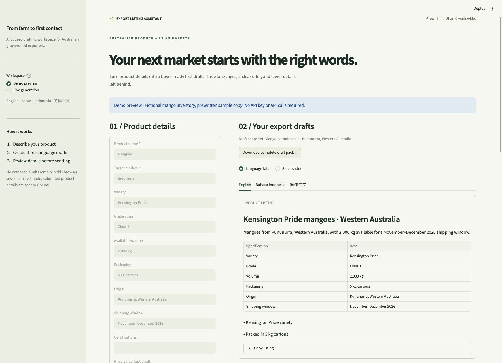

# Export Listing Assistant

**Grown here. Shared worldwide.**

A small AI application that helps Australian growers turn product details into B2B listings and first-contact buyer emails in **English, Bahasa Indonesia and Simplified Chinese**.

Built with **Python · Streamlit · OpenAI Responses API · Pydantic**. Runs immediately in demo mode, without an API key.



## Why this exists

A grower may know their produce inside out but still need help presenting it to buyers overseas. This project brings the product offer, multilingual outreach and missing-detail review into one focused workspace.

The scope is deliberately small: describe a product, prepare three drafts, review what's missing. No CRM, database or automated email sending.

## What you can try

- Product form with variety, grade, volume, packaging, origin, certifications, shipping window, optional price and destination.
- Structured listings and buyer emails in three languages, with tabs or a side-by-side comparison.
- Copy controls and plain-text downloads for each language.
- One-click ZIP export containing all six drafts, source product details, and the review checklist.
- A self-contained `review.html` in every ZIP: open it in a browser to review all languages or print it.
- Field-specific guidance explains what to supply for each missing detail.
- Deterministic completeness checks for missing details, including phytosanitary information, shelf life, minimum order quantity and Incoterms.
- A fixed, clearly labelled mango demo and five illustrative WA product form presets.

**Demo mode is prewritten sample content, not AI generation.** The sample inventory is fictional. Live mode generates new drafts from submitted form data.

## Run locally

Requires Python 3.11–3.13.

```bash
python3 -m venv .venv
source .venv/bin/activate
pip install -r requirements.txt
streamlit run app.py
```

Open the local URL printed by Streamlit. On Windows, activate with `.venv\Scripts\activate`.

### Enable live AI generation

Copy `.streamlit/secrets.toml.example` to `.streamlit/secrets.toml` and configure:

```toml
OPENAI_API_KEY = "your-key-here"
OPENAI_MODEL = "gpt-4o-mini"
ENABLE_LIVE_GENERATION = true
```

The same settings can be supplied as environment variables. Secrets are ignored by Git. Never paste a key into application code, screenshots or issue reports.

Select **Live generation**, choose a product preset, edit the details and generate. The model is configurable; your API project must have access to a model supporting structured outputs.

## Design decisions

```text
Product form → Pydantic input validation → OpenAI Responses API
                                       → Pydantic draft validation → Three language views
Product form → Deterministic completeness checklist
```

- **Typed output, not Markdown parsing.** A Pydantic schema requires a listing and email for each language. Specification rows use a typed list, avoiding arbitrary dictionary keys in strict JSON Schema. See the [official Structured Outputs guide](https://developers.openai.com/api/docs/guides/structured-outputs).
- **One call for three languages.** All drafts use the same product snapshot. Invalid structured output is retried once; incomplete and refused responses are surfaced safely.
- **Facts and checks have different responsibilities.** Prompts prohibit invented claims, but prompts and schema validation do not guarantee factual accuracy. The checklist is computed from submitted fields instead of model assertions. “Supplied” means present, not verified or compliant.
- **Safe public demo default.** Live generation is opt-in. A publicly deployed app with live mode enabled exposes paid generation to visitors; use demo-only mode for an unrestricted portfolio link, or add real authentication and server-side quotas before opening paid generation publicly.
- **Minimal retention.** The app has no database and keeps results in Streamlit session memory. Live requests send form data to OpenAI with `store=False`; this does not override the provider's other data-retention policies. API keys are server-side only. Raw API errors are not shown to visitors.

## Quality checks

```bash
pip install -r requirements-dev.txt
ruff check .
pytest -q
```

Tests cover all five fictional product fixtures, blank and whitespace input, missing export details, language-schema completeness, retry bounds, refusals, incomplete responses, output copying, demo rendering, and clearing stale results after a failed generation. API calls are mocked in automated tests. GitHub Actions runs the suite on Python 3.11, 3.12 and 3.13.

Live API quality and native-speaker review remain separate manual checks. No claim is made that the translations have been professionally reviewed or that any sample product is eligible for export.

## Publish the portfolio demo

1. Push this folder to a GitHub repository named `export-listing-assistant`.
2. In Streamlit Community Cloud, deploy the repository with `app.py` as the entry point.
3. Keep `ENABLE_LIVE_GENERATION` false for the public, no-cost demo; no secret is needed.
4. Put the deployed URL in the repository's **About → Website** field and pin the repository on your GitHub profile.
5. Record a short walkthrough using [the demo script](docs/portfolio.md), then add the real video link here.

Deployment, GitHub publication and a demo recording are not included in the local build. Add links only after they exist.

## Boundaries

This is a writing assistant, not a legal, regulatory or market-access service. Requirements vary by product and destination. Confirm them with the buyer and relevant authorities, review translations with a fluent speaker, and verify every claim before sending. The app does not send emails or certify readiness.

## License

MIT. See [LICENSE](LICENSE).
